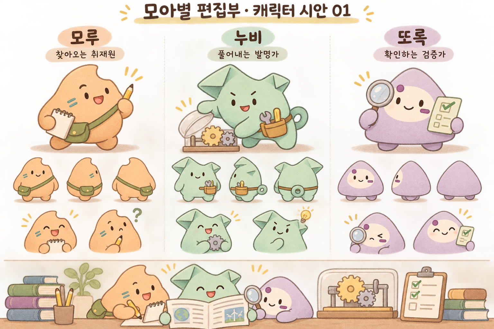

# 모아별 편집부 — 오리지널 캐릭터 시안 01

2026-11-15 사용자 요청으로 만든 AI 뉴스 그림책용 창작 시안. 이름은 가칭.

## 캐릭터 설정
- **모루 / 취재원**: 살구색 비대칭 물방울·조약돌 몸, 머리의 둥근 홈, 청록색 볼 자수 두 줄, 이끼색 메신저 가방, 작은 취재 수첩. 호기심이 많고 질문을 먼저 한다. 대사 예: “무슨 일이 생겼지?”
- **누비 / 발명가**: 민트색 접힌 연 모양 몸, 비대칭 접힌 모서리, 짧은 고리 꼬리, 황토색 공구 주머니. 기술을 분해해 설명한다. 대사 예: “안을 같이 볼까?”
- **또록 / 검증가**: 연보라 둥근 삼각 몸, 크림색 얼굴, 비대칭 자주색 동그라미와 짧은 막대 표식, 돋보기와 체크 카드. 결론보다 출처를 먼저 살핀다. 대사 예: “근거를 확인하자!”

## 그림책 적용
1. 매 생성 전 이 문서와 캐릭터 시트를 참고한다. 가능한 이미지 도구에 시트를 참조 이미지로 직접 제공한다. CLI 이미지 입력은 해당 도구 도움말로 지원 여부를 확인한다.
2. 세 캐릭터는 특정 기업의 마스코트나 대변인이 아닌 독립 편집부다. 회사 로고를 몸에 붙이거나 실제 인물을 이 캐릭터로 대체하지 않는다.
3. 뉴스에 따라 1~3명이 취재·실험·검증 행동을 한다. 모두를 매 구역에 반복하지 않는다. 장면·기계·수치·말풍선의 풍성함은 유지한다.
4. 색·실루엣·고유 소품을 유지한다. 표정/포즈/작업복은 변형 가능. 표식 좌우는 v1 시트의 큰 정면/3분의4 모습을 기준으로 고정하며 작은 턴어라운드의 불일치는 그대로 복제하지 않는다.
5. 얇은 갈색 선, 차분한 색감, 명확한 글자. 시트의 어두운 상단 음영은 그림책에 적용하지 않는다. 과도한 단순화·네온·두꺼운 검정선 금지.
6. 기존 유명 캐릭터·기업 마스코트·특정 작가 화풍을 닮게 요청하지 않는다. 등장한다고 해서 기사 내용이 검증됐다는 표식으로 쓰지 않는다.

## 제작 기록과 권리 유의점
- 사용자의 기여: 뉴스 그림책에서 지속적으로 활용할 귀여운 자체 캐릭터를 요청. 풍성한 묘사와 눈이 편한 표현의 조합 선호.
- AI의 기여: 팀 이름·세 역할·외형·색·성격·대사 설정 초안과 이미지 생성. built-in image_gen 사용.
- 생성 지시 요약: original invented creatures, Korean model sheet with three distinct silhouettes, front/side/back and expressions, apricot reporter / mint inventor / lavender evidence checker, no corporate mascots, no artist imitation; ivory paper and muted gouache.
- 원본 파일은 보존하고 개선본은 v2, v3로 별도 저장한다. 사용자 선택·수정과 사람의 직접 드로잉/편집은 실제 이루어진 내용만 날짜별로 기록한다.
- 저작권·상표의 독점성이나 비침해가 확인된 상태가 아니다. AI 생성물의 보호 범위는 국가와 사람의 창작 기여에 따라 달라진다. 이름·외형 유사성 검색 및 상표 조사는 아직 미실시. 단순 승인이나 기록만으로 저작권이 생긴다고 주장하지 않는다.
- 이 시안에 별도 공개 재사용 라이선스를 부여하지 않는다. 법적으로 성립하지 않는 권리를 새로 주장하지 않는다.
