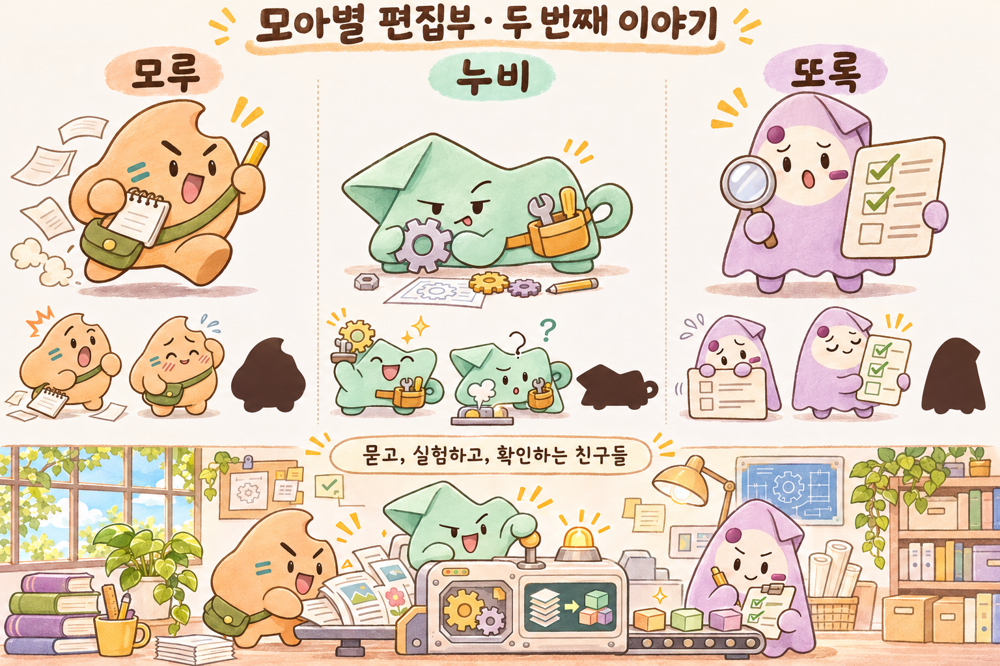

# 모아별 편집부 — 현행 디자인 v2

2026-11-15 사용자 요청: 유명 캐릭터 분석을 바탕으로 뉴스 그림책 캐릭터 재개발.

[분석·설계 근거](design-analysis-v2.md) · [이전 v1 기록](v1-design.md)

## 제작 우선순위
- **현행 참조는 assets/characters/moabyeol-v2.png**다. 과거 예약 작업에 v1 경로가 남아 있어도 이 문서의 v2를 우선한다. v1 이미지는 역사 보존용이다.
- 이미지 생성 전에 이 문서와 v2 시트를 실제로 보고, 지원되는 도구에는 참조 이미지로 전달한다. 실제로 전달하지 않았으면 참조 입력 성공이라고 보고하지 않는다.
- 이번 시트는 디자인·감정 연기 기준이다. 흑백 실루엣과 하단 장면은 설명용이며 정확한 치수 도면이 아니다. 아래 체형 기준을 우선한다.

## 캐릭터 고정 설정
### 모루 — 먼저 묻는 취재원
- 살구색 둥근 배/물방울형. 머리 윗부분 한쪽으로 휜 봉우리와 둥근 홈. 귀 없음.
- 정면 기준 보는 사람 왼쪽 볼에 청록색 짧은 두 줄. 이끼색 크로스백과 수첩.
- 중간 키, 짧은 다리, 앞으로 기울어 뛰는 자세. 호기심이 강하지만 성급해 메모를 떨어뜨리기도 한다.
- 바람: 모두가 이해하는 기사를 쓰기. 취미: 마음에 든 질문을 수첩 뒤에 수집하기.
- 말: “잠깐, 왜 그런 거야?” 실수하면 숨기지 않고 다시 묻는다.

### 누비 — 손으로 알아보는 발명가
- 민트색 낮고 넓은 접힌 천/리본형 몸. 정면 기준 왼쪽에 넓은 접힘 하나, 오른쪽 뒤에 고리 꼬리. 동물 귀 두 개처럼 만들지 않는다.
- 황토색 공구 주머니. 모루보다 낮고 넓으며 짧은 발과 팔이 구별된다.
- 몰입하면 반쯤 감은 눈과 비대칭 눈썹. 발명에 자신 있지만 설명이 길어지고 실험을 너무 많이 벌인다.
- 바람: 어려운 기술을 누구나 만져보게 만들기. 취미: 남은 부품 정리하기(정작 자기 책상은 어수선함).
- 말: “작게 만들어 보면 알 수 있어!” 실패한 실험은 결과를 고쳐 쓰지 않고 다시 한다.

### 또록 — 조심스럽게 확인하는 검증가
- 연보라색 길쭉한 종/책갈피 몸. 정면 기준 오른쪽 위 모서리 접힘 하나, 완만한 물결 밑단과 작은 발.
- 크림색 세로 얼굴 패치. 정면 왼쪽 관자놀이 자주색 점, 오른쪽 볼 자주색 짧은 막대.
- 모루보다 길고 가늘다. 큰 체크 카드를 껴안거나 뒤에서 빼꼼. 돋보기는 필요할 때만 든다.
- 틀릴까 봐 걱정하지만 근거를 찾으면 조용히 용기를 낸다. 확인이 오래 걸려 출발을 늦추기도 한다.
- 바람: 모르는 것을 편하게 말할 수 있는 편집부. 취미: 예쁜 색인표 모으기.
- 말: “아직 모르는 건 여기 표시하자.” 체크 카드가 기사 진실성을 보증하는 마크는 아니다.

## 관계와 그림책 적용
1. 모루가 질문 → 누비가 작은 실험 → 또록이 조건·출처 확인 → 셋이 설명을 고친다. 매회 같은 순서를 강제하지 않는다.
2. 역할은 동등하다. 또록은 단속자가 아니고, 누비는 만능 해결사가 아니며, 모루는 무지한 바보가 아니다. 서로 도와야 장면이 완성된다.
3. 뉴스마다 필요한 1~3명만 등장. 캐릭터가 기사 공간을 차지하지 않도록 정보·단면도·장치·숫자와 균형을 맞춘다.
4. 인물은 또렷하고 비교적 단순하게, 배경의 기계·현장 묘사는 풍성하게. 아이보리 배경, 얇은 갈색 선, 차분한 살구·민트·보라. 어두운 비네팅·네온·두꺼운 검정선 금지.
5. 같은 몸의 색만 바꾸지 않는다. 중간 둥근형/낮고 넓은형/길고 가는형을 유지한다. 소품 없이도 구별되는지 확인한다.
6. 공식 기업 마스코트·실제 인물의 대체물이 아닌 독립 편집부. 회사 로고를 몸에 붙이지 않는다. 실제 사건의 허구 목격담·검증 결과를 캐릭터 대사로 만들지 않는다.
7. 큰 모델 포즈를 고정 기준으로 쓰되 같은 화면의 작은 포즈에서도 접힘·볼 표식 방향이 바뀌지 않게 검사한다. 뒷모습은 이번 시트에 없으므로 정밀 턴어라운드 검증 완료라고 하지 않는다.

## 생성 지시 요약
built-in image_gen 사용, v1을 재개발 입력으로 제공. 이름과 역할 색은 유지하되 강한 체형 대비·결점과 감정 연기·상호협력 장면을 추가. 아이보리 배경의 3열 모델 시트, 각 1개 대표 포즈+2개 감정 포즈+실루엣, 아래 상세한 기억 압축 실험 편집실. 유명 캐릭터 이미지는 생성 입력으로 쓰지 않음. 특정 작가 화풍 모방 지시 없음.

## 제작 기록·권리
- 사용자: 독자 캐릭터 창작, 풍성하되 눈이 편한 그림, 유명 캐릭터 분석에 기반한 재개발 방향 지시.
- AI: 공식 소개 조사, 설계적 해석, 체형/성격/관계 초안, 이미지 생성 및 문서화.
- 이름은 가칭. 공식 소개 조사와 별개로 외형·이름의 포괄적 유사성/상표 조사는 미실시다.
- AI 생성만으로 독점 저작권·등록 가능성·비침해를 보장하지 않는다. 실제 사람의 창작 수정과 관할별 기준을 구분하며, 승인·기록만으로 권리가 발생한다고 주장하지 않는다.
- v1 및 v2를 보존한다. 이후 사용자의 구체적 수정과 사람이 실제 수행한 드로잉은 사실대로 기록한다. 별도 공개 재사용 라이선스는 부여하지 않는다.
