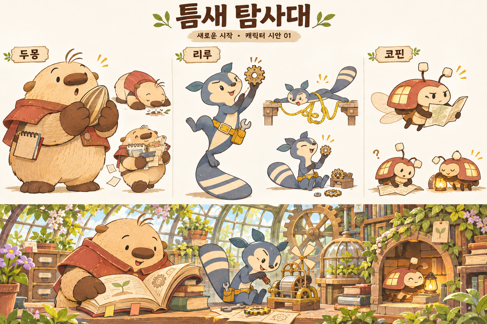

# 틈새 탐사대 — 새 출발 시안 01

2026-11-16 사용자 지시: “캐릭터 첨부터 다시 개발”. 모아별의 이름·외형·색 조합을 이어 쓰지 않고 새로 개발했다. 이름은 가칭.

## 현행 우선순위
- 신규 그림책은 이 문서와 **assets/characters/teumsae-v1.png**를 참조한다. 과거 모아별 지시보다 우선한다.
- 모루·누비·또록 및 moabyeol-v1/v2는 제작 기록으로만 보존. 새로운 캐릭터와 섞지 않는다. 기존 발행 이미지는 소급 변경하지 않는다.
- [직전 시안 기록](moabyeol-v2-design.md). 이전 유명 캐릭터 분석 문서는 역사 기록이며 새 시안 외형의 참조 입력이 아니다.

## 세계관
세상에서 이해되지 않는 틈을 탐험하는 작은 친구들. 온실과 도서관, 기계 공방이 연결된 탐사 기지가 집이다. 뉴스 현장마다 가설을 세우고 관찰·실험하며, 모르는 부분은 비워 둔다. 실제 기사 속 사건을 겪었다고 꾸며 말하지 않는다.

## 두몽 — 느긋한 현장 탐험가
- 귀리색 털의 땅굴 포유류형 창작 생물. 셋 중 가장 크고 두툼한 체형. 낮고 작은 둥근 귀, 넓은 갈색 가로 코, 머리 세 가닥, 넓은 삽 모양 갈색 손과 짧은 발.
- 녹슨 빨강색 짧은 탐사 재킷/어깨 덮개, 주머니 수첩. 슈퍼히어로 망토가 아니다.
- 잘 듣고 오래 관찰하지만 궁금한 자료를 모두 챙겨 짐이 많아진다. 작은 발견을 소중히 다룬다.
- 대사: “가까이 가서 들어 보자.” 취미: 사물의 촉감과 소리를 수첩에 기록하기.

## 리루 — 몸으로 실험하는 조립가
- 잿빛 파랑의 가늘고 긴 포유류형 창작 생물. 크림색 얼굴/가슴, 바깥으로 기울어진 짧은 잎 모양 귀, 길고 납작한 노 모양 꼬리의 크림색 띠 두 개. 겨자색 공구 벨트.
- 두몽보다 가늘고 작다. 꼬리로 균형을 잡거나 몸을 길게 펴며 도구와 함께 행동한다. 토끼 긴 귀·번개 꼬리·곱슬 꼬리로 바꾸지 않는다.
- 낙관적이고 손이 빠르지만 측정 줄자에 자기가 엉키기도 한다. 실패한 모형을 고쳐 다시 시도한다.
- 대사: “작은 모형으로 시험해 볼까?” 취미: 버려진 부품으로 움직이는 장난감 만들기.

## 코핀 — 작은 길잡이
- 셋 중 아주 작은 테라코타색 등불 딱정벌레형 창작 생물. 둥근 껍질 옆의 크림색 창문 패치, 크림색 작은 정육면체로 끝나는 짧은 더듬이 두 개, 작은 팔다리, 필요할 때 얇은 날개.
- 생물이지 로봇이 아니다. 창문은 따뜻하고 약한 호박색 빛. 지도·휴대 등불은 소품이며 진실을 판별하는 마법 장치가 아니다.
- 작은 글씨와 길을 잘 찾고 꼼꼼하지만 낯선 곳에서는 투덜거리며 지도를 다시 편다. 큰 친구들이 못 들어가는 곳을 살핀다.
- 대사: “이쪽은 아직 안 봤잖아.” 취미: 지도의 빈칸 채우기.

## 그림책 제작 기준
1. 문서와 시트를 보고 지원되는 이미지 생성 도구에는 실제 참조 이미지로 제공한다. 미제공 시 참조 성공을 주장하지 않는다.
2. 큰 두몽/가늘고 유연한 리루/매우 작은 코핀의 크기 대비를 유지한다. 시트는 가독성을 위해 개별 모델 크기를 확대했으므로 같은 장면에서 코핀을 두몽만큼 크게 만들지 않는다.
3. 대표 큰 포즈가 외형 기준. 작은 포즈의 생략된 부속을 새 설정으로 해석하지 않는다. 코핀은 손 두 개와 작은 보행 다리 네 개를 기준으로 하며 가려진 팔다리는 자연스럽게 생략한다. 정밀 턴어라운드는 아직 없다.
4. 한 장면에 필요한 인물만 배치. 정보·수치·현장 단면·기계·말풍선은 풍성하게 유지한다. 캐릭터 자체는 과밀하게 꾸미지 않는다.
5. 밝은 아이보리 바탕, 얇은 갈색 선, 차분한 귀리색/청회색/테라코타. 네온·암부 비네팅·강한 채도 금지. 같은 미소를 반복하지 않는다.
6. 특정 기업의 마스코트·대변인이 아니며 기존 유명 캐릭터의 외형·상징·로고를 차용하지 않는다. 가상의 설명 장면과 뉴스 사실을 구분한다.

## 행동 연출 — 2026-11-16 사용자 피드백 반영
오늘 그림에서 세 캐릭터가 세 구역 모두 같은 순서로 서서 바라보는 구도가 반복됐다. 배경은 풍성하지만 캐릭터는 관람객처럼 보였다. 다음 생성부터 아래 기준을 우선한다.

### 장면을 먼저 설계
- 구역마다 `목표 → 행동 → 작은 장애물 → 친구의 반응/도움`을 한 문장으로 설계하고 이미지 프롬프트에 포함한다. 한 프레임에는 그중 가장 잘 읽히는 순간만 그린다.
- 인물별 동사를 명시한다. “서 있다/바라본다/소품을 들고 있다”만으로 주요 행동을 채우지 않는다. 손·발·시선이 실제 대상과 접촉하거나 상호작용해야 한다.
- 세 명 일렬 배치와 동일 방향 응시를 구역마다 반복하지 않는다. 앉기·쪼그리기·매달리기·날기·받치기 등을 장면 목적에 맞게 달리한다. 억지로 모두를 매 구역에 넣지 않는다.
- 독자가 말풍선을 가려도 누가 무엇을 하며 누구를 돕는지 읽혀야 한다. 동작을 늘리느라 정보판·수치를 가리지 않는다.

### 성격을 보여주는 행동 사전
- 두몽: 무거운 모형 받치기, 쪼그려 작은 흔적 살피기, 흩어진 기록을 몸으로 받아내기. 힘과 느긋함을 행동으로 보여준다.
- 리루: 꼬리로 균형을 잡고 레버 당기기, 부품 끼우기, 길이를 재다 줄자가 엉켜 도움 청하기. 도구는 손과 실제로 연결한다.
- 코핀: 좁은 틈으로 날아 들어가 표식 비추기, 지도 펼쳐 길 안내하기, 높은 곳의 작은 글씨 가까이 살피기. 빛은 조명이지 마법의 사실 판정이 아니다.
- 한 명의 행동에 다른 인물이 놀람·집중·망설임·안도 등으로 반응한다. 매 장면을 활짝 웃는 얼굴로 통일하지 않는다.

### 뉴스 설명용 예시 — 실제 사건 재현이 아닌 가상 실험
- 산업의 연결 구조: 두몽이 기울어진 연결 블록 모형을 받치고 리루가 연결선을 따라 원인을 찾으며 코핀이 작은 라벨을 비춘다.
- 접근 보안: 모형 출입문에서 리루가 시험 카드를 대고 코핀이 결과 표시를 비추며 두몽이 권한 목록과 대조한다. 실제 침입 수법·범인·침해 경위를 창작하지 않는다.
- 음성 모델: 두몽이 시험용 수화기에 말하고 리루가 잡음 다이얼을 조절하며 코핀이 파형 기록을 살핀다. 독립 검증하지 않은 성능 수치를 이 실험에서 확인한 것처럼 표현하지 않는다.

### 생성 후 검토
같은 일렬 구도 반복, 인물과 도구의 무접촉, 장면 목적과 무관한 몸짓, 고유 꼬리/더듬이/크기 유실을 확인한다. 문제가 있으면 해당 장면 연출을 수정한다. 기존 발행본은 자동으로 덮어쓰지 않는다.

## 제작 기록과 권리
- 사용자 기여: 기존 캐릭터의 전면 재개발 요구. 풍성하되 눈이 편한 그림 선호는 유지.
- AI 기여: 새 이름·세계관·형태·성격·색·소품 설계와 built-in image_gen 생성. **기존 시안이나 유명 캐릭터 이미지를 참조 입력으로 제공하지 않았다.**
- 생성 지시 요약: original three-species expedition team, stout oatmeal burrowing mammal / slim slate-blue paddle-tailed glider / tiny terracotta lantern beetle; three model columns with emotional poses and rich mechanical greenhouse-library vignette; thin brown line, matte gouache, ivory background; no franchise references.
- 육안 확인: 이름·세 체형·감정 포즈·하단 협업 장면. 정밀 치수·턴어라운드·상표 및 외형 유사성 법률 검토 미실시.
- AI 생성만으로 독점 저작권·비침해·등록 가능성을 보장하지 않는다. 실제 사람의 창작 수정은 수행된 내용만 기록한다. 별도 공개 재사용 라이선스를 부여하지 않는다.
